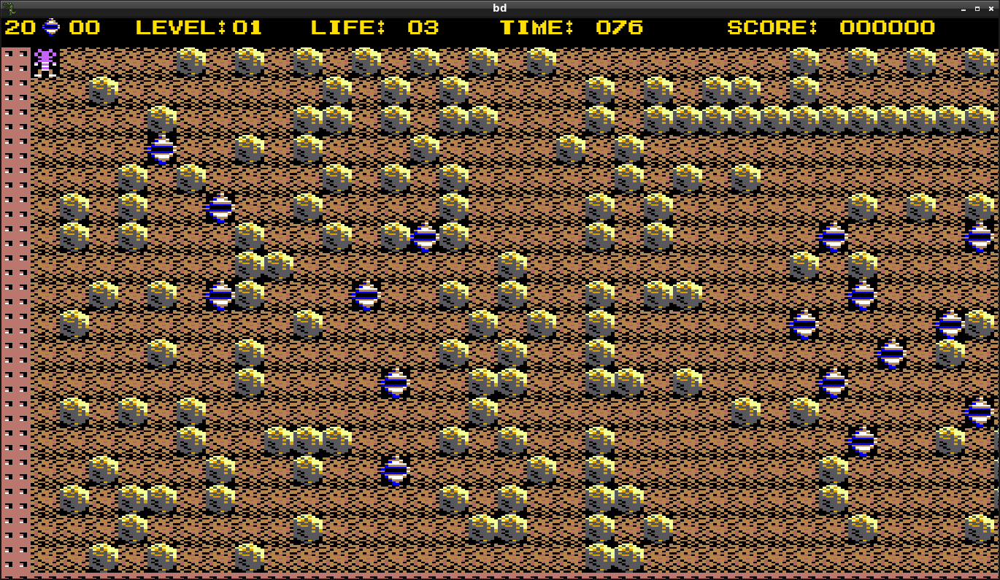
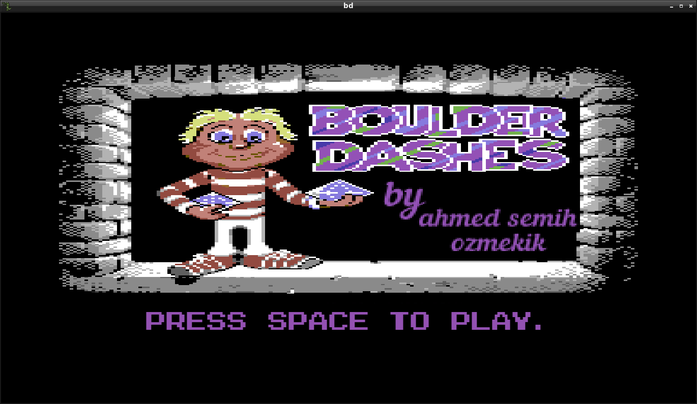

# Boulder Dash in C

A remake of the classic game Boulder Dash, written in C with Allegro 5. Dig through earth, collect diamonds, stay clear of falling rocks and enemies, and reach the door before time runs out. The ten levels are plain text files.

Written in 2018 and uploaded here in February 2019.

<p>
  
  
</p>

Gameplay video: https://www.youtube.com/watch?v=57r9qhH5WCM

## How it plays

- Rockford (`MINER` in the code) digs through earth and collects diamonds, 10 points each. Once he has the number the level asks for, a door appears next to him. Walking into it clears the level.
- Rocks and diamonds fall into empty cells. One that lands on Rockford kills him. He can push a rock left or right if the cell behind it is empty.
- Spiders move right if they can, otherwise down, otherwise left or up at random.
- Monsters chase Rockford. Each step they move one cell toward him, trying the vertical direction first and then the horizontal one. If both cells are blocked, they wait.
- Spiders and monsters move only through empty cells and kill Rockford on contact. A falling rock that lands on one kills it and turns the cells around it into diamonds.
- Water spreads into neighbouring earth once per second. Rockford cannot walk through it.
- Each level has a time limit, and the music speeds up in the last ten seconds. Rockford starts level n with n + 2 lives and restarts at the top-left corner after a death. Running out of time or lives restarts the level.
- Clearing levels 1 to 9 adds 20 points per second left and 10 per life left. After level 10 the game shows the final score.
- The view scrolls with Rockford in a 1366x768 window with 40-pixel tiles. The top bar shows diamonds needed and collected, level, lives, time and score.

## Controls

| Key | Action |
| --- | --- |
| Space | Start, or resume after a pause |
| Arrow keys | Move |
| Esc | Pause |
| Close the window | Quit |

## Levels

`Levels/LEVEL_1.txt` to `Levels/LEVEL_10.txt` start with four header lines: the number of diamonds that opens the door, the map size (rows and columns), the time limit in seconds, and two camera scroll factors. A `-` line follows, then the map. The start of level 1:

```
20
20 40
80
1.7 1.8
-
BBBBBBBBBBBBBBBBBBBBBBBBBBBBBBBBBBBBBBBB
BMEEEEREREREREREREREEEEEEEEREREREREREREB
```

| Char | Object | Char | Object |
| --- | --- | --- | --- |
| `B` | border wall | `M` | Rockford's start |
| `E` | earth | `S` | spider |
| space | empty | `!` | monster |
| `R` | rock | `W` | water |
| `*` | diamond | `D` | door |

Spiders appear in levels 5, 6, 8, 9 and 10, monsters in levels 6, 8, 9 and 10, and water in levels 7 and 10.

## Building and running

Needs gcc, pkg-config and Allegro 5 with the addons the `Makefile` asks pkg-config for: `allegro-5`, `allegro_dialog-5`, `allegro_ttf-5`, `allegro_image-5`, `allegro_audio-5` and `allegro_acodec-5`.

```sh
make
```

This compiles `bd.c` into `./bd` and starts it. Run it from the repository root, because textures, sounds, the font and the levels are loaded by relative path.

## Layout

- `bd.c`: main loop, input, and the game logic (rocks, spiders, monsters, water, levels, score bar)
- `bd.h`: sound and bitmap globals, `load_bitmap_at_size()`
- `Objects.h`: object IDs and the `Miner`, `FallingObject`, `MovingObject` and `Level` structs
- `Levels/`, `Textures/`, `Sounds/`, `Font/`: level files and assets

## Notes

- The textures in `Textures/` and the sounds in `Sounds/` were picked to look and sound like the original game. They are not the author's work, and the repository does not record where they came from.
- `Font/zig.ttf` is the Zig font by Tepid Monkey Fonts, according to the font file's own metadata.
